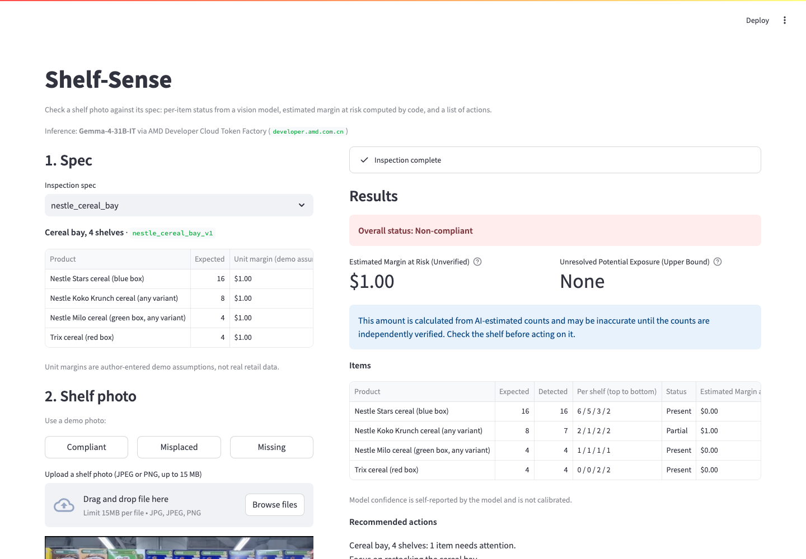

# Shelf-Sense

**Photograph a shelf, check it against its planned layout, and get a list of restocking actions with an estimated margin at risk.**

Built for the AMD Developer Hackathon: ACT III, *Reinvent Commerce* track.

Store staff check shelves by eye, rarely and inconsistently, and small retailers can't afford dedicated shelf-scanning hardware. Shelf-Sense takes one ordinary photo and a short spec of what the shelf should hold. A vision-language model on AMD Developer Cloud reports what it sees for each product. Plain Python then works out the compliance verdict and the dollar estimate, and writes the action list. **The model never produces the verdict or the money figure; code does, from the model's structured observations**, and the figure is clearly labelled as unverified.



*A real inspection of `data/demo/compliant.png` on the AMD endpoint. The shelf is fully stocked, but the model misses one half-hidden Koko Krunch box. The app reports the resulting $1.00 as an unverified estimate and shows per-shelf counts so a person can check them. See [Evaluation](#evaluation).*

## Features

- **Upload or pick a demo photo, choose a spec, run one inspection.** Single-page Streamlit app with empty, loading and error states, and a retry button.
- **Per-product results:** expected vs. detected counts, per-shelf counts (top to bottom), status (present / partial / missing / misplaced / needs review), and the model's own note.
- **Estimated Margin at Risk (Unverified):** computed by code with Decimal arithmetic from the counts and the spec's unit margins. It's shown separately from *Unresolved Potential Exposure (Upper Bound)* for items that need review. Items with missing or invalid unit values are reported as *unavailable*, never as $0.
- **Action note:** a deterministic template that always works. On top of it, an optional AMD-worded version where the model may only choose wording and order; every name, count, status and dollar figure is inserted by code. The app always shows which of the two produced the note.
- **Safety checks:**
  - Unusable model output gets one stricter retry, then "needs review" with the raw text shown. No figures are calculated from it.
  - Products the model invents are dropped. Products it doesn't mention become "needs review", not "missing".
  - Counts the model flags as unreliable, or whose per-shelf numbers don't add up, become "needs review".
  - Model confidence is displayed but never trusted.
- **Transparency:** the model name, endpoint host, inspection and note latency, and whether a result is real or mock are always shown. `MOCK_MODE` puts a warning on the page and a "MOCK RESULT" label on every result.

## How this uses AMD

- **Inference:** every inspection makes one real HTTPS call to the AMD Developer Cloud **Token Factory** OpenAI-compatible endpoint (`https://developer.amd.com.cn/radeon/api/v1/chat/completions`). It uses **Gemma-4-31B-IT** with the photo attached inline as a base64 JPEG. A second, text-only call to the same endpoint words the action note. There is no other model provider anywhere in the real path.
- **Evidence:**
  - [`docs/m0_response.txt`](docs/m0_response.txt): the first raw HTTP 200 from the endpoint, with the API key and its hash removed.
  - [`docs/experiments/`](docs/experiments/): 24 experiment records of real endpoint calls (successful runs and timeouts), including the raw model replies.
- **Latency:** in 9 recorded whole-image inspections at production settings, the median was **18.2 s** (range 11.7–45.8 s). The AMD-worded note adds roughly 4–15 s. The endpoint is shared, so latency varies a lot, and one HTTP 429 (rate limit) was seen and absorbed by the client's backoff.
- **What we don't claim:** Token Factory is a hosted service. We call its API and don't run the server ourselves, so we have no `vllm serve` command to show. The endpoint's responses identify the provider only as `self-dploy`; we have not verified which serving software or GPU it runs on.
- **Model choice:** [`scripts/probe_models.py`](scripts/probe_models.py) checks which listed models accept images. MiniCPM-V-4.7-35B-A3B was compared directly (Experiment 3). It was no more accurate, and 4 of its 6 attempts timed out.
- **Endpoint quirk:** this deployment returns HTTP 500 for a *system message plus an image*, so all instructions are sent in the user message.

## Setup

Requires Python 3.11 and Token Factory credentials.

```bash
git clone <this repo> && cd <repo>
python3.11 -m venv .venv && source .venv/bin/activate
pip install -r requirements.txt
cp .env.example .env          # then fill in real values. Never commit .env
streamlit run app/app.py      # http://localhost:8501
```

| Variable | Meaning |
|---|---|
| `AMD_API_URL` | Token Factory base URL ending in `/v1` (we use `https://developer.amd.com.cn/radeon/api/v1`) |
| `AMD_API_KEY` | Your Token Factory API key, sent as `Authorization: Bearer …` |
| `MODEL_NAME` | `Gemma-4-31B-IT` |
| `MOCK_MODE` | `false`. Set `true` only for offline UI work: it returns a fixed fake result, makes no AMD call, and every page and result is labelled MOCK. |

**Docker** (credentials are passed at runtime; `.dockerignore` keeps `.env` out of the image):

```bash
docker build -t shelf-sense .
docker run -p 8501:8501 --env-file .env shelf-sense
```

The container listens on `$PORT` when a host such as Render sets it. On a hosted service, put the four variables in the service's environment settings.

**Command line:** one inspection, printing the validated JSON result:

```bash
python -m app.inspector --spec specs/nestle_cereal_bay.json --image data/demo/compliant.png
```

**Check AMD access:**

```bash
python -m scripts.probe_models          # lists models, tests which ones read an image
```

## Architecture

A single Python process. Streamlit calls plain modules directly: no separate API service, no database, no login.

```
photo + spec (specs/*.json)
   │
   ▼  app/pipeline.py       validate image (≤15 MB, decodable)
   ▼  app/inspector.py      EXIF-rotate, resize to ≤1024 px, JPEG → prompt (spec as text, no prices)
   ▼  app/amd_client.py     POST /chat/completions → AMD Token Factory (Gemma-4-31B-IT)
   │                        timeouts, 429 backoff, clear error stages
   ▼  app/models.py         Pydantic validation; 1 stricter retry; else "needs review"
   ▼  inspector.build_result drop invented items, flag omitted / unreliable / inconsistent counts,
   │                        verdict computed by code
   ▼  app/calculator.py     Estimated Margin at Risk (Unverified) — pure functions, Decimal
   ▼  app/action_agent.py   template note; optional AMD wording, validated, else template
   ▼  app/app.py            UI (app/presenters.py formats; no business logic in the UI)
```

| Path | Purpose |
|---|---|
| `app/` | Application modules (above) |
| `specs/nestle_cereal_bay.json` | The demo spec: 4 products, expected counts, $1.00/unit **demo** margins |
| `data/demo/` | The demo photo `compliant.png`, its ground truth and its crop bands |
| `data/unmatched/` | Self-taken photos without a matching spec yet (not offered in the app) |
| `eval/` | Experiment runners and the frozen baseline prompt |
| `docs/experiments/` | Every experiment run, raw replies included, and the write-up |
| `tests/` | Offline test suite, plus one opt-in live test |

## How the money figure works

**Unit value** = `unit_margin_usd` from the spec. In the demo spec it is a flat **$1.00 per unit: an author-entered demo assumption, not real retail data**. The figure is one-off gross margin on the missing units. It is not revenue and not a daily rate.

| Item status | Estimated Margin at Risk (Unverified) | Shown as |
|---|---|---|
| present | $0 | no issue |
| missing | expected units × unit value | estimate |
| partial | (expected − detected) units × unit value | estimate |
| misplaced, needs review, unreliable or contradictory counts | excluded ($0); upper bound (expected units × unit value) shown separately | unresolved issue |
| unit value absent, negative or not a number | no amount, with the reason; the total becomes "at least $X" | unavailable |

- **Every amount is an unverified estimate.** The counts come from the model, and a count can be valid and self-consistent but still visually wrong (see [Evaluation](#evaluation)). Results carry `counts_verified`, which is always `false`: nothing in the app verifies counts, so no figure is ever labelled as verified.
- **An estimate of $0.00 is never shown as "no action required"** while unresolved items remain.

## Evaluation

All numbers below come from [`docs/experiments/`](docs/experiments/README.md). They cover **one** self-taken photo, `data/demo/compliant.png` (a fully stocked shelf), with a ground truth counted by hand (`data/demo/compliant.truth.json`: Stars 16, Koko Krunch 8, Milo 4, Trix 4). This is a single-image case study, not a benchmark.

| Experiment | Change | Exact product counts | Total count error | Shelf classified correctly |
|---|---|---|---|---|
| Baseline | first prompt | 1/4 (2 runs) | 8 | 0/2 |
| 1 | shelf-by-shelf counting prompt (**production**) | 3/4 (3 runs) | 1 | 0/3 |
| 2 + replication | 1536 px instead of 1024 | 3/4 (6 runs) | 1 | 0/6 |
| 3 | MiniCPM-V-4.7-35B-A3B instead of Gemma | 3/4 (2 of 6 attempts completed) | 1 | 0/2 |
| 4 | one image per shelf, hand-placed crops | 2–3/4 (3 runs) | 2–3 (overcounts) | **3/3** |

**Production setup:** Gemma-4-31B-IT, whole image, 1024 px, shelf-by-shelf prompt.
- Across all 9 recorded runs, Koko Krunch was counted as **7 of 8 every time**. The model misses a box half-hidden on shelf 2, so the fully stocked shelf is reported **non-compliant** with a false $1.00 estimate.
- The model marked that count reliable, at 100% confidence.

**Per-shelf cropping (Experiment 4)** found the hidden box, but it also overcounted partly visible neighbouring boxes. On a real stock-out, an overcount could hide a gap. It also needs 4 calls per inspection and used hand-placed shelf boundaries. For these reasons it was **not** adopted.

## Testing

```bash
pytest                # offline suite; AMD responses mocked, no credentials needed
pytest -m live -s     # opt-in: one real AMD inspection of data/demo/compliant.png
```

**Offline: 181 passed, 1 deselected** (the live test). It covers:
- schema validation, retries and the needs-review fallback;
- the client's error handling (unreachable, timeout, HTTP errors, 429 backoff);
- the calculator, with all statuses, missing or invalid values and cent-exact rounding;
- the action note, including rejecting AI wording that changes figures;
- regression tests that money is never presented as verified;
- presenters and the full Streamlit app, driven headlessly (mock mode, failures, invalid images, no repeat inference on rerun).

**Live:** passed against the real endpoint. It checks that a real, complete result comes back, not that the counts are right; accuracy is measured in `docs/experiments/`.

## Limitations

- **Counting accuracy:** the model misses partly hidden packages. Its confidence and "reliable" flags don't reveal this. Every money figure is therefore labelled *unverified* and should be checked on the shelf.
- **One evaluated photo:** results are a case study, not a benchmark.
- **Demo scenarios:** only `compliant.png` has a matching spec and ground truth. Two more self-taken photos (`data/unmatched/missing.png`, `misplaced.png`) show different shelves and have no spec yet. They're kept out of `data/demo/` so the app offers only the **Compliant** demo button. The three-scenario demo (compliant / stock-out / misplaced) is **not** complete.
- **Hand-written specs:** specs are written by hand, with no auto-discovery of the shelf layout. There is no placement field, so "misplaced" can only mean "mixed in with another product".
- **Demo margins:** unit margins are demo assumptions, not point-of-sale data.
- **Scope:** single store and single session; no history, login or persistence.
- **Endpoint:** latency on the shared endpoint varies widely (11.7–45.8 s per inspection).

## Licences and attribution

Shelf-Sense is released under the [MIT licence](LICENSE).

| Dependency | Licence | Use |
|---|---|---|
| Streamlit | Apache-2.0 | UI |
| Pillow | HPND | Image decoding and resizing |
| requests | Apache-2.0 | HTTP client |
| pydantic | MIT | Schema validation |
| pytest | MIT | Tests |
| AMD Developer Cloud Token Factory | Service terms of AMD | Hosted inference (called over HTTPS; no code included) |

No AGPL or unclear-licence code is included. The zero-shot vision-inspection pattern was conceptually inspired by the MIT-licensed *AsBuilt-Lens* project, which applied it to PCB assembly checks. No code from it is used. All demo photos were taken by the project author.
